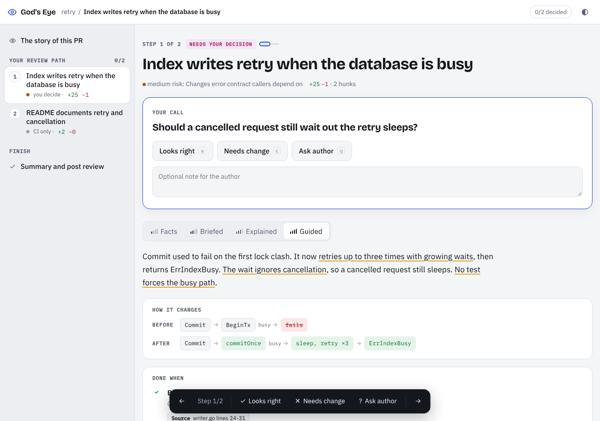

# 👁 God's Eye

**PR review you can read in two minutes.**

Agents write more code than people can read line by line. God's Eye doesn't try to read *for* you. It tells you **what changed, whether it did what it claims, and which parts need your decision**, in as few words as possible.



## What it does

1. **Splits the PR into units.** A unit is one *behaviour* change ("Index writes retry when the DB is busy"), not a file.
2. **Sorts units by who must decide:**
   - **Needs your decision:** security, data, money, concurrency, intent conflicts, or anything with a verified bug
   - **Agent reviewed:** real logic, but the evidence covers it
   - **Static / CI:** no behaviour change
3. **Hunts for bugs with code access.** Parallel agents read the repository at the PR head (`read_file`, `grep`, `list_files`), follow callers, and report only bugs they can back with a concrete scenario.
4. **Verifies every finding by vote.** Three independent verifiers each check the finding a different way: try to disprove it, trace it with real inputs, check callers and config. Only a majority survives. Findings whose quoted code doesn't exist are dropped before voting.
5. **Checks the "done when" criteria** from the PR, linked issues and `REVIEW.md` / `CLAUDE.md`. A `not_done` claim goes through the same vote.
6. **Shows each unit at four depths:**

| View | What you get |
|---|---|
| **Facts** | Files, line counts, touched functions, check tally and the diff. No prose. |
| **Briefed** | Verified bugs, one short paragraph with the claims to verify underlined, and a before → after flow. |
| **Explained** | The flow, plus notes on the 2-4 lines that carry the change, pinned in the diff. |
| **Guided** | Done-when checklist with evidence, blast radius, and a ready-to-send change request. |

No style comments or "consider…" suggestions. Severity is decided by the voters: **Bug** blocks the PR, **Minor** is shown but doesn't block, and harmless findings are dismissed. Bugs that already existed before the PR are listed separately, so the author isn't blamed for them.

## How a review runs

```
gh / git ──► diff (H1..Hn) ──► caller index (git grep for every changed symbol)
                 │
                 ├──► mapper ─────────────► units, tiers, flows, checks
                 ├──► hunter × N slices ──► candidate bugs (quote + scenario)
                 │                               │
                 │          drop invented quotes, merge duplicates
                 │                               │
                 └──────────────► 3 voters per finding ──► confirmed / minor / pre-existing / dismissed
```

- **Depth:** `--depth quick` (mapper only), `standard` (default: hunters + 3 voters), `deep` (two hunter lenses per slice: logic and contracts).
- **Cost control:** every agent shares one cached prefix (tools, system prompt, PR header), so most input tokens are cheap cache reads. Each hunter sees only its slice of the diff, verifiers only the hunk in question. `--budget` stops new verifications above a spend limit.
- **Re-review rounds:** the state of each review is saved in `.godseye/state/`. On the next run, hunters look only at what changed since the last reviewed commit and are told what was already reported. Earlier bugs whose code is gone are marked **Fixed**. From round 3, the page suggests rethinking the approach instead of patching line by line. Use `--fresh` to start over.
- **Empirical evidence:** `--verify-cmd "go test ./..."` runs the command in the checkout and feeds its output to every agent.

## Install

```bash
go install github.com/ShivamPansuriya/gods-eye@latest
```

The binary is `gods-eye`. Rename or alias it to `godseye` if you like. Needs [`gh`](https://cli.github.com) for PR mode and an Anthropic API key:

```bash
export ANTHROPIC_API_KEY=sk-ant-...
```

## Use

```bash
gods-eye 123                        # review PR #123 in the current repo
gods-eye https://github.com/o/r/pull/123
gods-eye 123 --repo owner/name
gods-eye --local --base main        # current branch vs main, no GitHub needed
gods-eye 123 --comment              # also post a short summary on the PR
gods-eye 123 --effort medium        # cheaper / faster
gods-eye 123 --save r.json          # keep the raw review; re-render with --from r.json
```

It writes a single HTML file to `.godseye/pr-123.html` and opens it.

## Reviewing on the page

1. **The story of the PR** comes first: why it exists (from the description, or inferred from code and marked as such), what it changes overall, before → after, who it affects, and where your judgement matters.
2. **Your review path** walks the units in priority order. Each step asks you **one question** ("Should existing Table exports default to STACKED?"). Answer with **Looks right** (`a`), **Needs change** (`c`) or **Ask author** (`q`) and the page moves to the next step.
3. **Verified bugs** in a unit need your call: **Agree** puts them in your review, **Not a bug** overrules the AI. A step with an undecided bug won't let you mark it "Looks right" until you decide.
4. **Summary** turns your decisions into a review: a verdict (it can't be Approve while a verified bug is undecided), a "Must fix" list, questions, and what looks right. Edit it, then copy the text or the `gh pr review` command.

Progress is kept in your browser per PR and commit. Keys: `j` / `k` move, `1`-`4` switch views, `s` summary.

## Risk rules

Path rules can only **raise** a unit's tier, never lower it. Built in: CI workflows, auth, billing, payments, permissions, migrations, and secrets always need a person. Add your own in `.godseye.json` at the repo root:

```json
{
  "rules": [
    { "glob": "src/updater/**", "tier": "human", "reason": "auto-updater" },
    { "glob": "docs/**",        "tier": "static", "reason": "docs" }
  ]
}
```

Tell the reviewer what matters in your code with a `REVIEW.md`. It's read on every run, along with `CLAUDE.md` and `AGENTS.md`.

## Run on every PR (GitHub Action)

See [`.github/workflows/godseye.yml`](.github/workflows/godseye.yml). It posts the summary comment and uploads the full page as an artifact. Add `ANTHROPIC_API_KEY` to the repo's secrets.

## Measure it: the eval

Following the article's "our incidents are the eval": `evals/cases.json` lists PRs with known bugs. `gods-eye eval evals/cases.json` reviews each one and reports which bugs were caught, missed, or found but voted down, plus extra confirmed findings and the cost. Add a case every time a bug slips through review. Rerun the eval after any change to prompts, tools or model.

```bash
gods-eye eval evals/cases.json
```

## Try it without an API key

```bash
go run . --diff examples/retry.diff --review-file examples/retry.review.json
```

## How it works

```
gh pr view / gh pr diff ──► diff parser (hunks H1..Hn, line numbers)
            │                        │
  PR body, linked issues,            ▼
  REVIEW.md, CLAUDE.md ──► Claude (structured JSON output, word limits)
                                     │
                                     ▼
              Finalize: every hunk in exactly one unit, path rules raise tiers,
              a failing check forces "human", invalid line refs are dropped,
              long text is trimmed
                                     │
                     ┌───────────────┴───────────────┐
                     ▼                               ▼
          single-file HTML page              Markdown PR comment
```

Default model: `claude-opus-5-5` at `high` effort. The CLI and the page show tokens, cache hit rate and cost per stage after each run.

## Roadmap

- Intent-conflict detection against past PRs and decisions
- Learn from dismissals: feed rejected findings back as "known false positives" per repo
- Auto-generate a failing test for each confirmed bug
